this will be the guide for the new shulker farm related issues
First of all
NEVER bring your shulker using a boat into this farm always use minecarts
Boats mess up shulker alignment and boats wont be able to eject the shulker properly and your shulker will be stuck 

If u already did bring it with a boat and the shulker is still in the boat  then 
Watch this guide on how to align the shulker properly before breaking the boat watch from min 12:49
https://youtu.be/s7JZWGcnHYA?si=KnhUdR-STxwp3chx
I
If you already destroyed the boat try and bring it back to the boat and follow the same guide
It should work and if it doesn't or if u dont wanna do the boat thing then bring a new shulker using a minecart
Also know that even if you got your shulker in a boat even  once then used a minecart after your shulker will still be at the wrong alignment and you would still need to follow the steps above to correct it 
Second you need to check some stuff 
Can you see or hear the piston continously firing ?
And the trap door near it closing and opening ?
If yes go to next step
If no
You need to change some stuff
Omar MokhtarRole icon, Moderator — 11/26/25, 3:02 PM
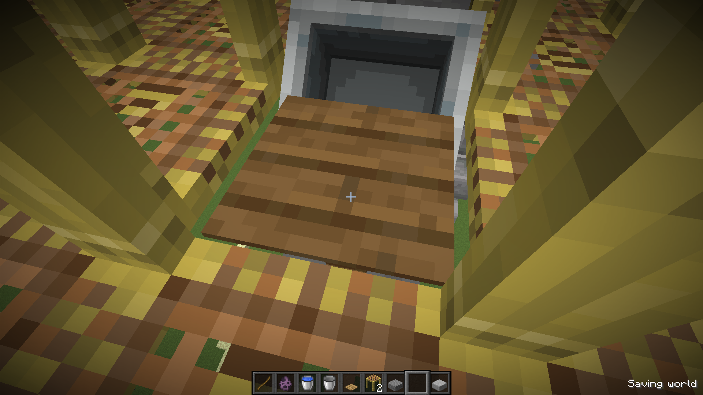
Remove this pressure plate and place it again ( the one near the pistons and snow golems )
Then you should see the piston and trapdoor firing
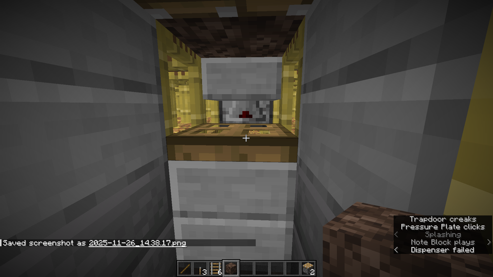
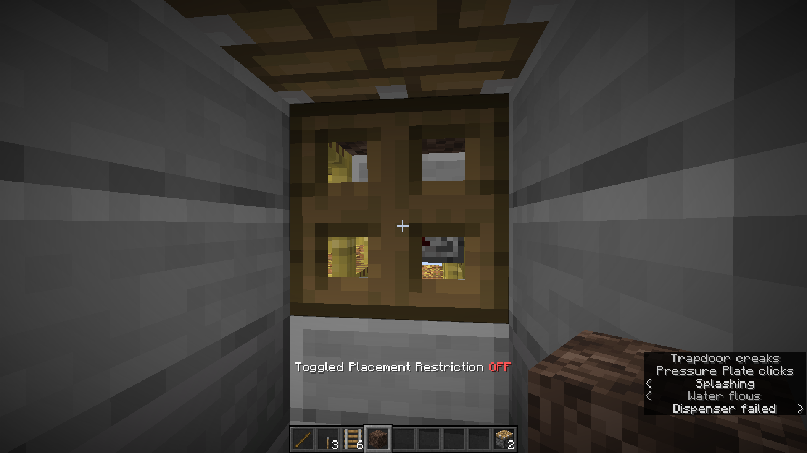
Make sure your trapdoor opens into this side as shown in the pic above
U can do so by placing it from the minecart side if u already built the farm
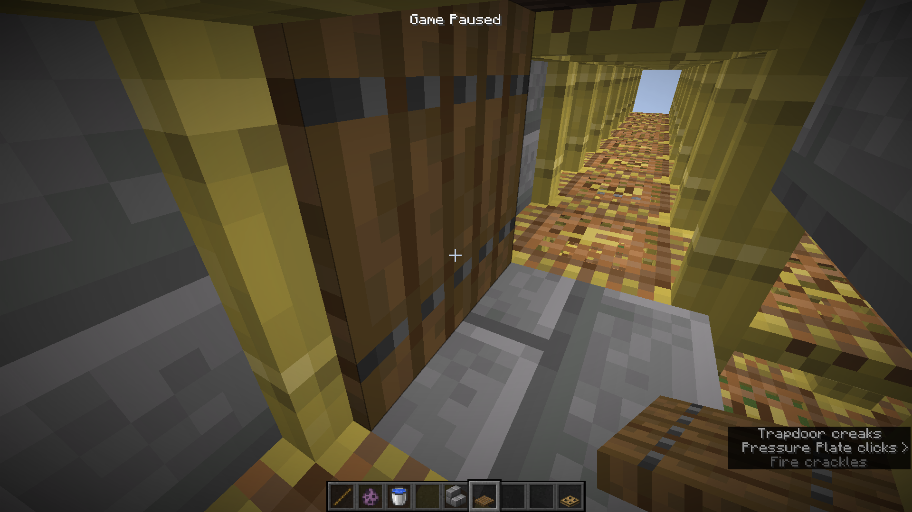
Like this
Then you need to check boat alignment
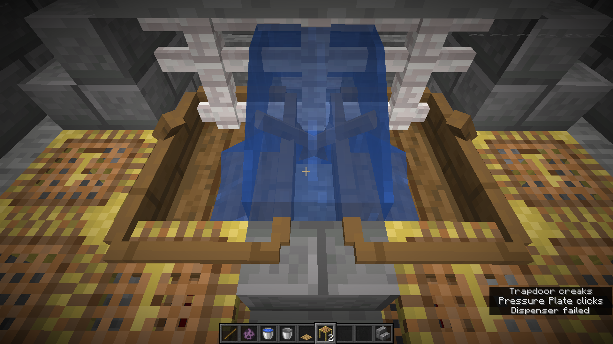
This is the correct alignment and they should be facing south 
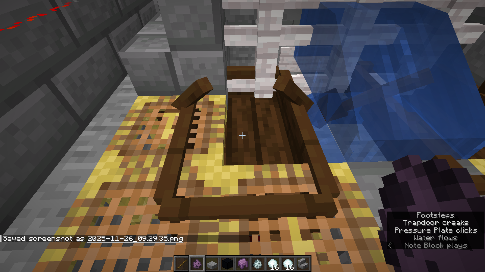
If ur boat looks like this then u need to fix it
Simply destroy both boats
Then make sure that the dispenser near them is continuously firing
If not
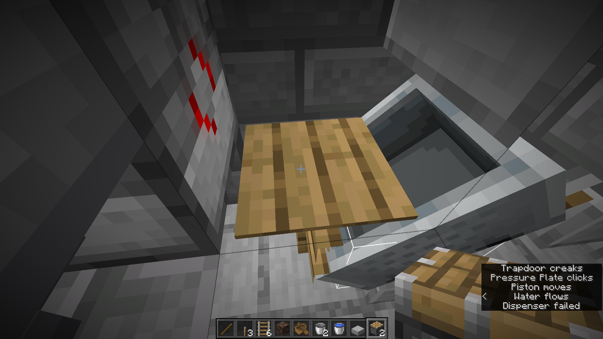
Then u need to destroy the pressure plate behind the dispenser and place it again and it will be fixed
And while u r there place 2 boats into the dispenser 
Make sure that the area where the boats will be placed are fully built before u put them into the dispenser
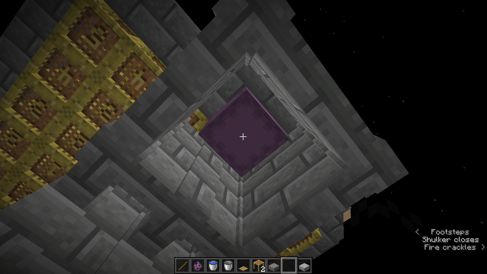
Omar MokhtarRole icon, Moderator — 11/26/25, 3:09 PM
If your shulker is just sitting here dont worry this is normal 
This is the back up chamber 
Simply open the trap door the shulker is sitting on and it will teleport away
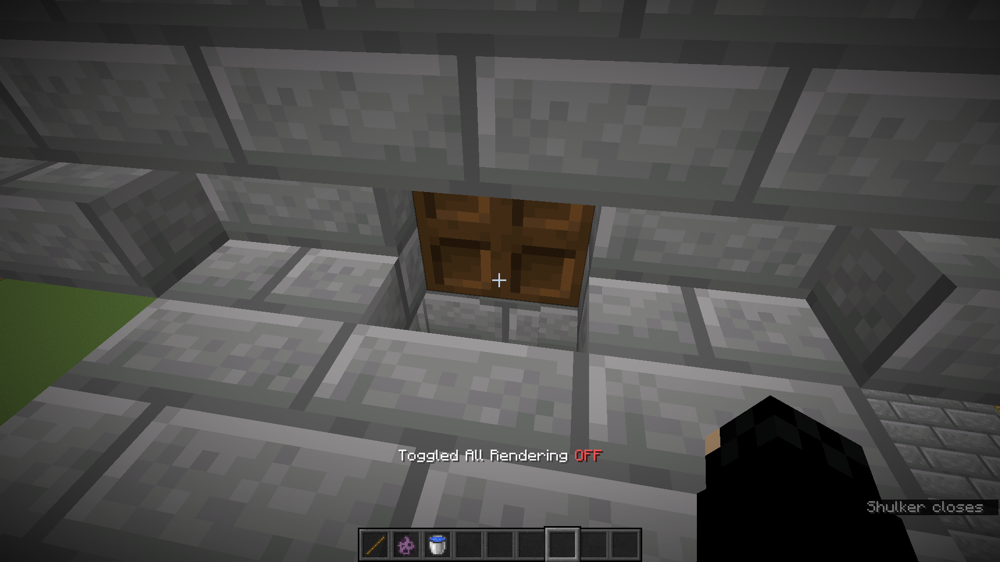
U can open it from above here
Then after ur shulkers have duped and the farm been working for a while
Close that trap door again to have a back up shuker always there in case anything goes wrong
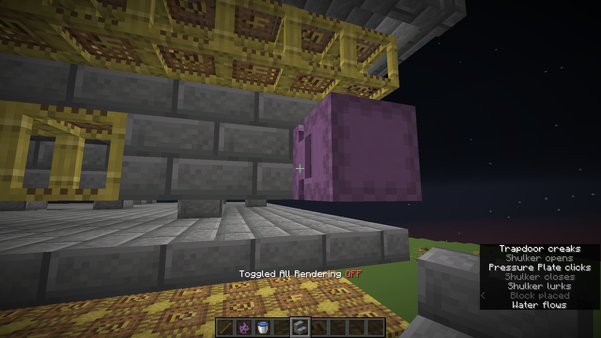
Pls be careful not to leave any surfaces where shulkers can teleport like in the pic above
So double check your build
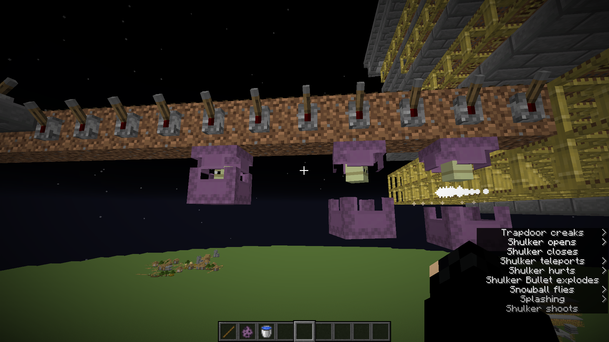
Omar MokhtarRole icon, Moderator — 11/26/25, 3:12 PM
Make sure to teleport proof all surfaces while transporting your shulkers so this doesn't happen
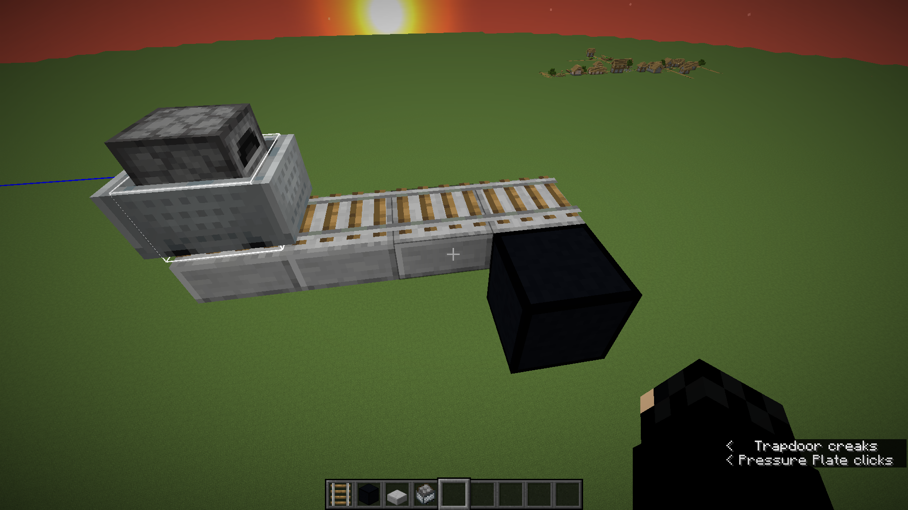
Best way to transfer shulkers is just using top slaps with rails on them 
Use furnace minecart to push the shulker minecart in place
If you wanna use full blocks for building or decorating your build 
Please teleport proof them using buttons on all 6 exposed sides so shulkers dont teleport there
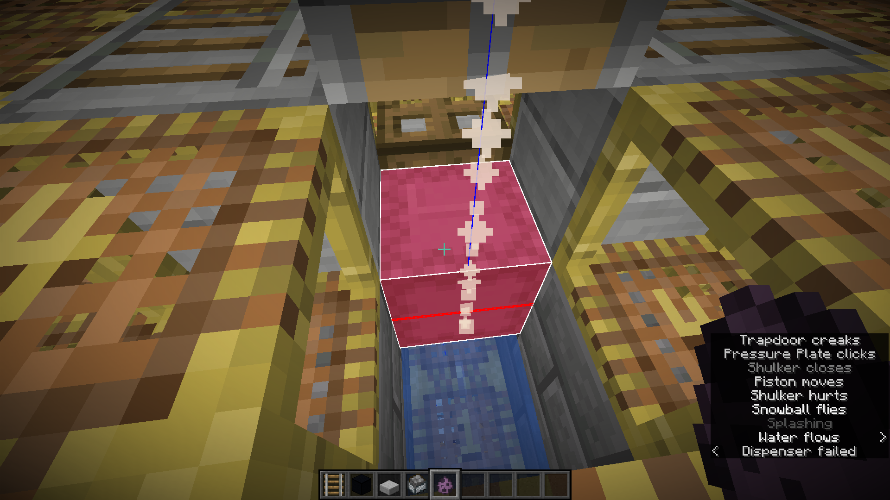
your shulker should be open when it is getting hit by the snow golems
otherwise it wont dupe and it will die
to fix it just come closer to it and let it see u so it opens and dupes
Also please make sure you are not on peaceful mode
Another thing to note is that your shulker should be above 50% hp for it to dupe normally otherwise it might die 
So if you damaged your shulker while transporting it from the end city
Please consider splashing your shulker with a health or a regeneration splash potion before you release it into the farm or even if you already released it there is no harm in splashing it with these potions if u recall your shulker being damaged while transporting it 
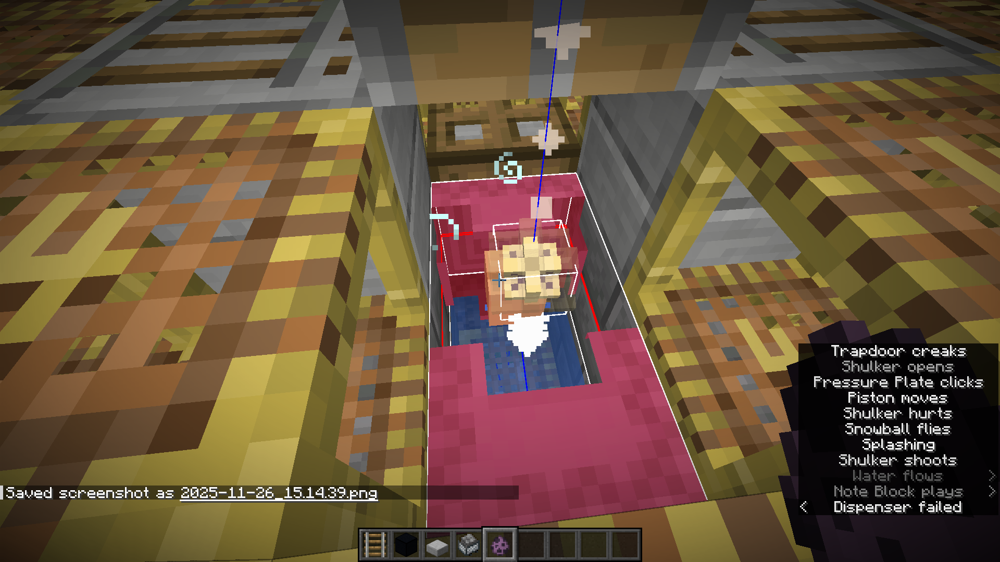
Your shulker should be open like this
Also make sure you placed the string just in front of the shulker in the picture above 

Omar MokhtarRole icon, Moderator — 11/26/25, 3:16 PM
If your snow golems are dying please refrain from building the farm in the biomes mentioned above and dont expose them to rain
Lastly 
U can use the schematic below to make your life easier and make sure the farm is built correctly
Attachment file type: unknown
/for-wiki/Shulker Farm og.litematic
19.14 KB
Also make sure that shulkers dont see you that much 
By flying on top of the farm for example 
This can make them agro on you and that will make their bullets path unpredictable and can destroy the boats or kill snow golems 
Just get what u want from the chests and get away
Hope this guide helped
If not feel free to make a ticket in ⁠🆘╏support  and mention me there or helper team
Have a nice day 
And enjoy your farm 
Omar MokhtarRole icon, Moderator — 1/2/26, 10:14 AM
If your shulker isn't getting in the right chamber ( near the snow golem ) or teleporting away instantly 
Then it is most likely too low on hp so it instantly teleports away so it doesn't die
So consider healing it with a regeneration or health splash potion
Also make sure u placed the string near it ( the single string near the snow golems area not the ones near the boats up top )
Also please be patient as your shulker may take some time to realise there is a valid teleport spot near the golems where he should normally be for the farm to function
So consider giving it some time
Maybe reloading the area or your world